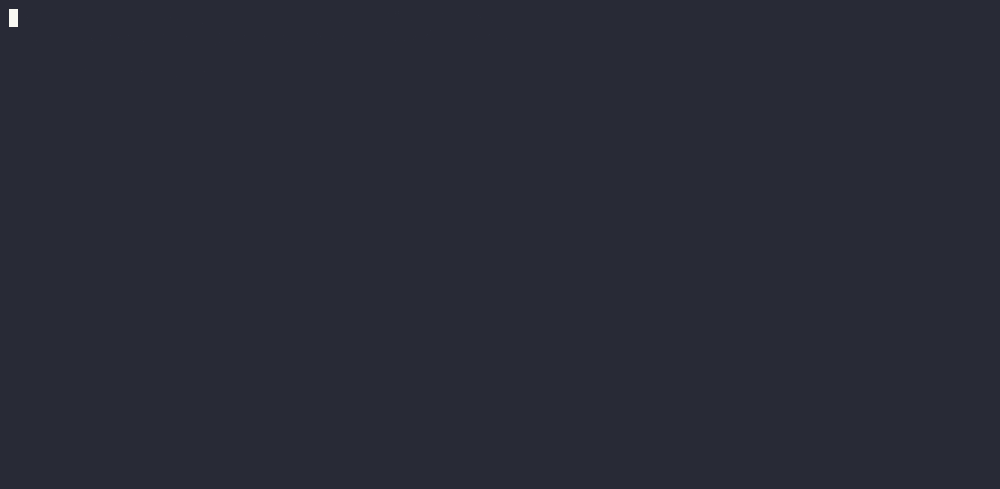

# AttackSurfaceX (ASX)


[](https://github.com/gevarru/AttackSurfaceX/stargazers)



Safe, **non-destructive** attack-surface scanner for websites and servers you own or are explicitly authorized to test.
CLI-first, plugin-based, with JSON / Markdown / interactive-HTML / SARIF reports. MIT licensed.

أداة فحص سطح هجوم **آمنة وغير تدميرية** للمواقع والسيرفرات التي تملكها أو مخوّل بفحصها خطياً.
واجهة CLI، بنية إضافات (Plugins) قابلة للتوسعة، وتقارير بعدة صيغ. ترخيص MIT.

> ⚖️ **Legal / قانوني**: Only scan systems you own or have **written authorization** to test. The authors accept no liability for misuse. لا تفحص إلا أنظمة تملكها أو مخوّل بفحصها خطياً، والمطورون غير مسؤولين عن أي سوء استخدام.

## Features

- **Ports**: asyncio TCP-connect scan (no raw sockets, no nmap required), banner grabbing, risky-service flagging.
- **TLS**: certificate expiry, deprecated protocol detection (TLS 1.0/1.1), cipher info — read-only handshakes.
- **Web**: security headers, cookies flags, CORS, version disclosure, exposed sensitive paths, sensitive-data patterns, inert-canary injection & reflected-XSS indicators.
- **Scope enforcement**: nothing is scanned unless declared in `scope.yaml`. Wide port scans need an explicit flag.
- **Profiles**: `safe` (default, passive), `balanced`, `deep` (inert canaries, requires `allow_active_checks: true`).
- **Plugins**: Python plugin API with a safety gate (plugins importing `os`/`subprocess`/`socket` are rejected).
- **Rules**: declarative YAML rules, validated via `asx rules validate`.
- **Reports**: JSON, Markdown (GitHub-Issues friendly), interactive HTML with severity filtering, SARIF for GitHub Code Scanning.

## Install

```bash
pipx install git+https://github.com/gevarru/AttackSurfaceX.git
# or: pip install .
# or: docker build -t asx . && docker run --rm asx --help
```

Requires Python 3.11+.

## Quick start

```bash
# 1. Declare scope — mandatory mindset: only what you own
cp examples/scope.yaml scope.yaml   # edit hosts:

# 2. Full safe scan
asx scan --target https://forum.absba.cc --scope scope.yaml --profile safe \
  --format html --output report.html

# 3. Ports only
asx ports --host forum.absba.cc --scope scope.yaml --top-ports 100 --rate 100

# 4. Plugins & rules
asx plugins list
asx plugins info missing-xfo
asx rules validate --rules asx/rules/security_headers.yaml

# 5. Re-render an old JSON result as HTML
asx report --input results.json --format html --output report.html
```

## Use as an AI agent skill

ASX ships with a portable skill at [`skills/asx-security-scan/SKILL.md`](skills/asx-security-scan/SKILL.md) — a single `SKILL.md` (YAML frontmatter + instructions) that teaches any compatible agent how to run ASX safely: authorization gates, the `safe` profile, output interpretation, and the real-world lessons baked in (SPA catch-alls, geo-filtering vs TLS failure, dedup metadata).

Works with **Kimi Agent**, **Kimi Claw**, **Kimi Code**, **Claude Code**, and **Codex CLI** — same file, every agent. Invoke it with your agent's skill/command picker, or let the agent auto-load it when the task matches.

## Architecture

```
asx/
  cli.py               Typer CLI: scan / ports / plugins / rules / report
  core/
    models.py          Finding, Severity, Confidence, ScanResult
    scope.py           Scope parsing + enforcement (the safety gate)
    http.py            Rate-limited, self-identifying HTTP client (GET/HEAD only)
    rate_limit.py      Async token bucket + concurrency semaphore
  scanners/
    ports.py           asyncio TCP-connect scanner
    tls.py             TLS protocol/certificate audit
    web/
      headers.py       Headers, cookies, CORS, version disclosure, data patterns
      paths.py         Exposed sensitive files (with 404-baseline detection)
      injection.py     Inert-canary error-pattern indicators (no exploitation)
      xss.py           Inert-canary reflection-context indicators
      crawler.py       Shallow same-host crawler
  plugins/             Plugin API + safe loader + bundled example
  rules/               YAML rules engine + bundled rules
  reporters/           JSON / Markdown / HTML / SARIF
```

## Writing a plugin

```python
META = {"name": "my-check", "version": "1.0.0", "description": "What it does"}

from asx.core.models import Finding, Severity, Confidence

async def run(ctx):
    resp = await ctx.http.get(ctx.base_url)
    # ... analyse passively ...
    return []  # list[Finding]
```

Rules of the game: passive analysis only. Plugins importing `os`, `subprocess`,
`socket`, `ctypes` etc. are **refused by the loader**. Drop the file in a
directory and pass `--plugins-dir`.

## Development

```bash
pip install -e .[dev]
pytest -q
ruff check asx tests
mypy asx
```

## Roadmap

- [x] MVP: CLI, scope, ports, headers/TLS, JSON/Markdown reports
- [x] Plugin loader + YAML rules + example plugin
- [x] HTML / SARIF reporters
- [ ] CSRF & form-analysis module
- [ ] Session/authenticated scanning helpers
- [ ] SBOM / supply-chain module (OSV integration)
- [ ] Resume support for long scans

## Disclaimer

AttackSurfaceX **detects indicators, not exploits**. It never runs payloads,
never changes server state, and never attempts privilege escalation. A clean
report does not guarantee a secure system — treat results as leads to verify.

## License

MIT — see [LICENSE](LICENSE).
